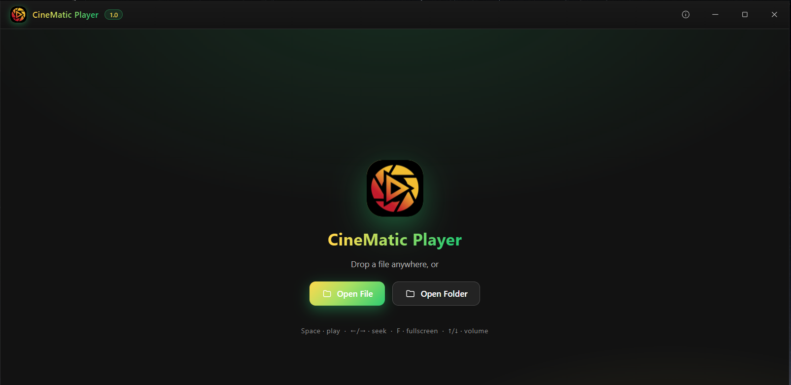

# 🎬 Cinematic Video Player

**A modern, fast, and elegant video player built with Rust + Tauri.**

A lightweight desktop video player for Windows, designed for a smooth and immersive viewing experience.

 

---

## 🖼️ Screenshots

---

## ✨ Features

- Clean and modern user interface
- Smooth local video playback
- Lightweight Windows desktop application
- Built with Rust and Tauri for performance
- Easy-to-use controls

---

## 🚀 Getting Started

### Download

Go to the [Releases](https://github.com/Rohit5984/CineMatic-Video-Player-/releases/tag/1.0.0) page and download the latest version for Windows.

---

## 🛠️ Tech Stack

| Technology | Purpose |
|---|---|
| Rust | Backend, performance, and system-level logic |
| Tauri | Lightweight desktop application framework |
| HTML / CSS / JavaScript | Modern user interface |

---

## 🤝 Contributing

Bug reports, feature ideas, and pull requests are welcome.

Please report bugs or suggest new features through [GitHub Issues](https://github.com/Rohit5984/CineMatic-Video-Player-/issues).

---

## ⭐ Support the Project

If Cinematic Video Player is useful to you, giving it a ⭐ helps more people discover the project and supports future improvements.

---

## 📄 License

This project is licensed under the [MIT License](LICENSE).
